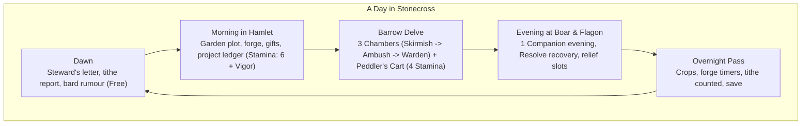
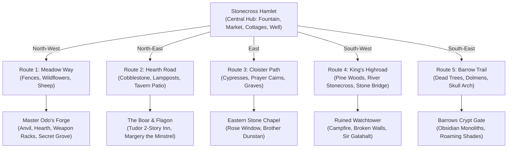
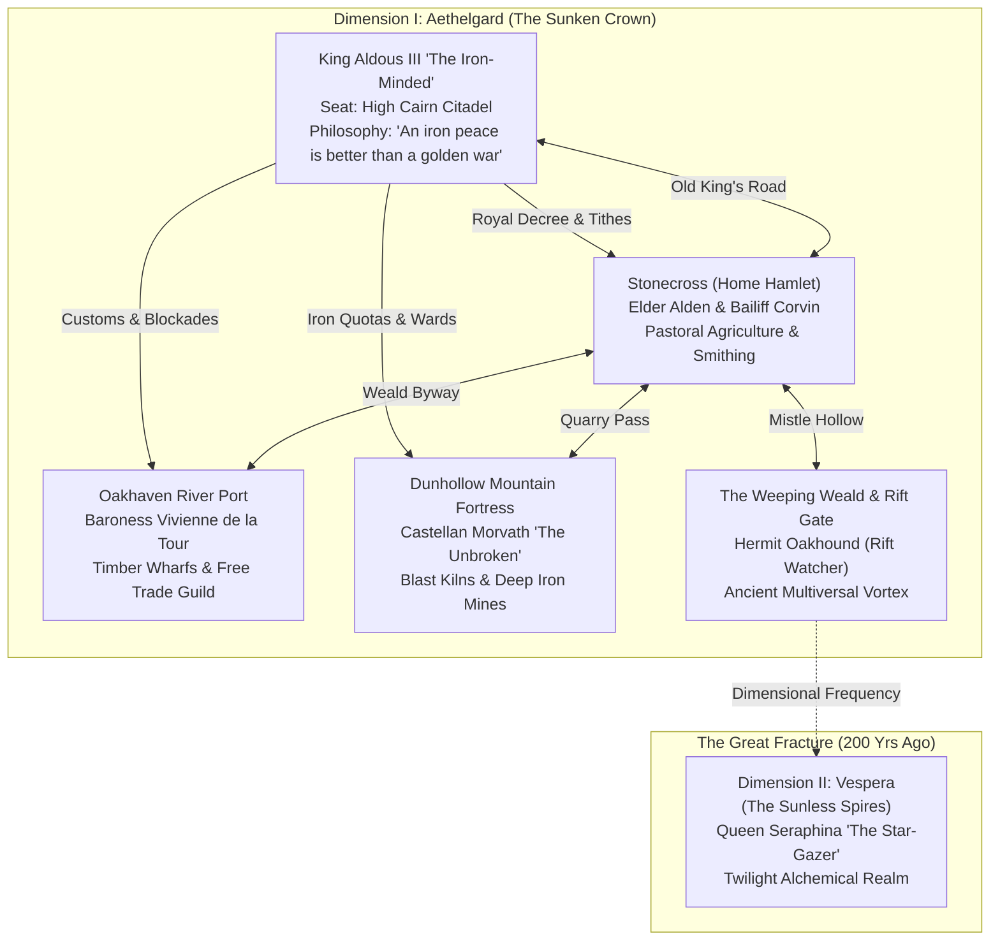
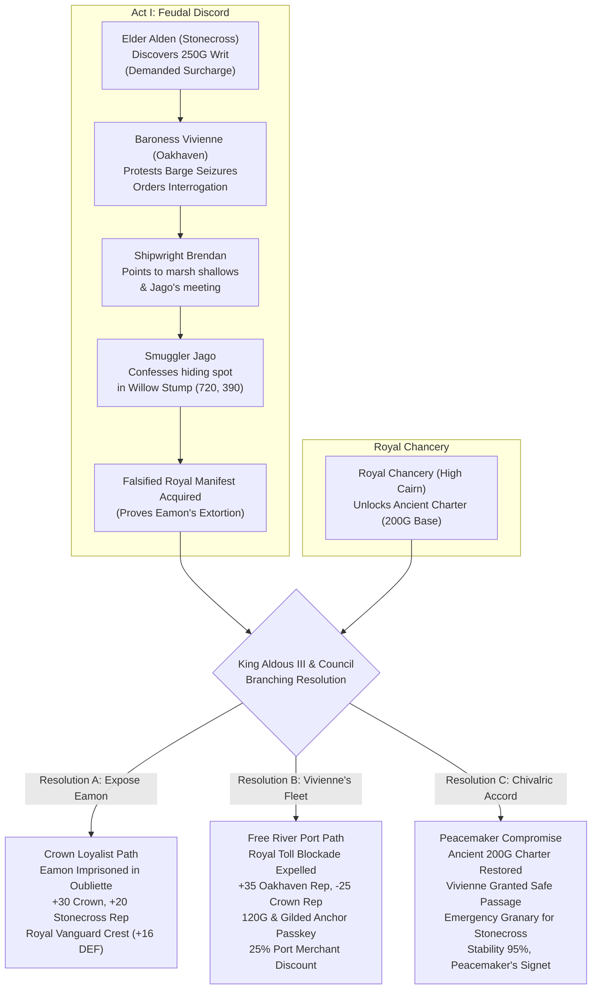
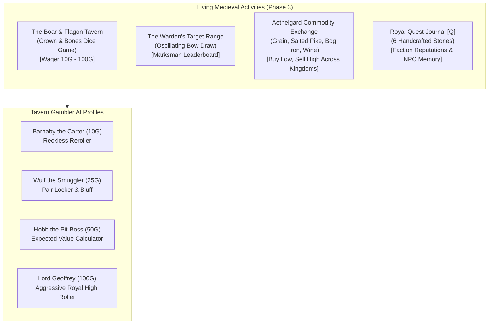

# Crown & Crucible: Master Design Dossier
*Researched mechanics behind Stardew Valley, Undertale, Balatro, Incremental RPGs, and Medieval Games, synthesized into original, numbered systems for Stonecross.*

---

## 1. Executive Summary & Top Directives



### Top 5 Architectural Rules
1. **Build the card fight first**: Might × Fervor card combat inside a 3-chamber barrow delve is the core engine. The hamlet feeds the deck, companions add cards/specials, and the forge/rank systems carry long-term scaling.
2. **Cards are your equipment**: Each equipped item adds 2–4 cards to a shared party deck (~24 cards total). Forging a weapon directly makes its cards hit harder.
3. **Grant Quarter (Mercy) is a real economy path**: Spared highwaymen become hamlet workers; tamed boars stock the sty; laid-to-rest shades grant Renown and Chronicle pages. Mercy feeds the tithe instead of costing XP.
4. **The Four Medieval Quarter Days are rent deadlines**: Each 14-day season ends with tithe due to the royal lord (Lady Day 200g, Midsummer 500g, Michaelmas 1,200g, Christmas 2,800g), functioning as seasonal economic boss checks.
5. **Keep rarity, finish, wax seal, and temper separate**: 
   - Frame color = Rarity (Iron → Steel → Silver → Gilded → Royal Astral).
   - Foil Finish = Separate rare roll (Plain, Silvered, Gilt, Royal Astral Holographic, Palimpsest).
   - Wax Seal = Socketed utility badge (Crimson, Ducal Gold, Episcopal Violet, Verdigris, Mourning Black).
   - Temper = Blacksmith enhancement (Whetted, Runic Inlay, Damascened, Blessed, Counterweighted).

---

## 2. Card Combat & The Damage Formula

### Round Structure
1. **Armory Deck**: 3 party members yield ~24 cards. Cards belong to 5 tinctures:
   - **Gules** (Strike / Red)
   - **Azure** (Ward / Blue)
   - **Vert** (Craft / Green)
   - **Or** (Faith & Coin / Gold)
   - **Sable** (Guile & Poison / Black)
2. **Draw 7, Play up to 4**: 2 Plays and 2 Regroups (discards) per round.
3. **Blazons Formed**:
   | Blazon | Cards Played | Base Might | Base Fervor |
   | :--- | :--- | :---: | :---: |
   | **Lone Charge** | Any 1 card | 5 | 1 |
   | **Pair** | 2 of one tincture | 10 | 2 |
   | **Counterchanged** | 2 pairs | 20 | 2 |
   | **Triad** | 3 of one tincture | 30 | 3 |
   | **Fellowship** | Cards from 3 different party members | 35 | 3 |
   | **Quartered** | 4 different tinctures | 40 | 4 |
   | **Full Arms** | 4 of one tincture | 60 | 6 |

### The Damage Formula
$$\text{Damage} = \left(\text{Blazon Might} + \sum \text{Card Might} + \text{Stat}\right) \times \left(\text{Blazon Fervor} + \sum +\text{Fervor} + \lfloor \text{Chivalry} \div 5 \rfloor\right) \times \prod \times\text{Fervor} \times \frac{100}{100 + \text{Armor}}$$

- **Stat Scaling**: Vigor for Gules/Azure, Agility for Sable, Arcana for Vert, Chivalry for Or.
- **Card Might**: $\text{Base} \times (1 + 0.1 \times \text{forge level})$.
- **Critical Strike**: $\text{Agility} \%$ (capped at 50%), dealt at $\times 1.5$.
- **Defense Phase**: Enemy attacks inside a 5-second dodge box. Azure cards held back in hand slow missiles by 10% each and block incoming hits.
- **Victory Condition**: Enemy HP reduced to 0, OR **Grant Quarter** once Parley requirements are met.

---

## 3. Launch Item Cards (20 Words or Fewer)

| Card | Tier | Tincture | Effect (≤ 20 words) |
| :--- | :--- | :--- | :--- |
| **Rusty Shortsword** | Iron | Gules | +4 Might. Gains +1 Might permanently for every 3 delves it survives equipped. |
| **Peasant Gambeson** | Iron | Azure | Held in hand: missiles in the defense phase move 10% slower. |
| **Pilgrim's Badge** | Iron | Or | +1 hand size on the first round of every fight. |
| **Tempered Longsword** | Steel | Gules | +8 Might. +2 Fervor if it is the only Gules card played. |
| **Chainmail Hauberk** | Steel | Azure | Held in hand: the first hit of each defense phase is blocked. |
| **Bellringer's Hammer** | Steel | Vert | Retrigger the first card played each round. |
| **Crusader's Broadsword**| Silver | Gules | +12 Might. ×2 Fervor against undead. |
| **Knightly Pavise** | Silver | Azure | When regrouped (discarded), gain 1 Ward charge for the next defense. |
| **Tithe Ledger** | Silver | Or | +1 Fervor per 10 gold held, up to +10. |
| **Reliquary Finger-bone**| Silver | Or | Whenever you grant quarter, +1 Might to this card permanently. |
| **The King's Bastard Sword** | Gilded | Gules | ×1.5 Fervor. Costs 5 gold each time it is played (royal upkeep). |
| **Sun-Emblazoned Cuirass** | Gilded | Azure/Or | Each Or card in the play gives +3 Fervor. |
| **Hourglass of Compline** | Gilded | Sable | ×1.5 Fervor on night delves, ×0.75 on day delves. |
| **Excalibur of the Lake** | Royal Astral | Gules | ×3 Fervor. Only draws if the bearer has Chivalry 30 or more. |
| **The Jester's Royal Deck** | Royal Astral | Sable | After each play, flip a Royal Tarot for a random ×1 to ×4 Fervor. |

---

## 4. Modifiers: Finishes, Wax Seals, Tempers & Banner Charges

```
+-------------------------------------------------------+
| CARD MODIFIER ANATOMY (4 Independent Slots)          |
| 1. RARITY FRAME  : Iron -> Steel -> Silver -> Gilded  |
| 2. FINISH (FOIL) : Plain, Silvered, Gilt, Holographic|
| 3. WAX SEAL      : Crimson, Ducal Gold, Violet, Black |
| 4. TEMPER        : Whetted, Runic Inlay, Damascened   |
+-------------------------------------------------------+
```

### Banner Charges (Joker Sigils on Party Standard)
- **Lion Rampant**: +4 Fervor on every play.
- **Crossed Keys**: Retrigger every Or card.
- **Hare Courant**: +1 card drawn each round.
- **Broken Lance**: ×2 Fervor while only one party member is standing.
- **Millwheel**: +2 Might per finished hamlet project.
- **Bell and Rope**: +1 Play on the first round of each fight.

---

## 5. Companions & Resolve System

| Companion | Traits | Special Card | Bond 4 / 8 Unlock |
| :--- | :--- | :--- | :--- |
| **Sir Galahalt** | Honorable, Cynical, Stubborn | *Stand and Deliver* (Halves damage taken next defense) | Reflects 20% / Gains Kite Shield Azure card |
| **Margery** | Witty, Reckless, Generous | *The Fool's Gambit* (50% for x2 Fervor, 50% for Might = Gold) | Coin flip call / 6th Royal Tarot slot |
| **Brother Dunstan** | Jovial, Gluttonous, Devout | *Keg of Blessed Mead* (Heals party, stuns foe) | Cleanses poison / Mead becomes Gilt card |

- **Resolve (0 to 100)**: Reaching 100 triggers a 4-humour temperament:
  - *Choleric*: Acts autonomously, hits hard.
  - *Melancholic*: Skips plays.
  - *Sanguine*: Gambles gold.
  - *Phlegmatic*: Refuses to dodge.
  - *Virtue (25% chance)*: Steadfast, Inspired, or Zealous.

---

## 6. The Blacksmith Economy & Pilgrimage Prestige

### Forge Cost Schedule
$$\text{Cost} = 25 \times 1.6^{\text{level}-1}$$
- **Safety Net**: A failed forge never drops a level; instead, **Anvil Heat** adds +10% success to the next attempt.
- **Pilgrimage Reset**:
  $$\text{Lineage} = \left\lfloor \sqrt{\frac{\text{Lifetime Renown}}{500}} \right\rfloor$$
  Each Lineage point permanently awards **+5% Might** and **+5% Tithe Gold** across all future generations.

---

## 7. Prototype Implementation Plan in GameMaker

1. **Scoring Sandbox**: Might × Fervor card math, Blazon detection, animated popup.
2. **Turn-Based Battle State Machine**: Draw 7, Play 4, Regroups, Defend phase, Win/Quarter.
3. **Dialogue Engine**: Typewriter text with per-character audio blips (Galahalt metallic creak, Margery lute pluck, Dunstan warm hum).
4. **Barrow Delve**: 3 chambers (Skirmish, Ambush, Warden) + Peddler's Cart.
5. **Parley & Grant Quarter**: Non-violent resolution feeding hamlet workers and sty beasts.
6. **Blacksmith & Forge Math**: Anvil Heat and affix rerolls.
7. **Finishes, Wax Seals, and Banner Charges**.
8. **Day Clock & Overnight Pass**.
9. **Dodge Phase Box**.
10. **Hamlet Projects & Quarter-Day Tithes**.

---

## 8. Undertale Battle Architecture & Grand World Systems

### Undertale Battle Loop Integration
1. **[FIGHT] Strike Timing Reticle**:
   - A sliding reticle sweeps across an attack gauge.
   - Hitting near the center yields critical multipliers ($\times 1.5$ damage).
   - Base damage is determined by equipped weapons ($stat\_atk$).
2. **[ACT] Reasoning & Mercy Unlocks**:
   - Engaging the foe with dialogue or moral reasoning satisfies their unique pacification requirement.
   - Upon success, the foe's name turns **YELLOW**, unlocking the MERCY action.
3. **[ITEM] Consumables**:
   - Restores hit points (e.g. *Blessed Monastery Mead* restores 12 HP).
4. **[MERCY] Grant Quarter**:
   - Sparing a pacified enemy peacefully concludes the encounter and yields alternative rewards (mercy gold, hamlet recruits).
5. **Central Bullet Dodge Box (Soul Defense Phase)**:
   - When the enemy attacks, the player's Red Soul Heart enters the central battle box.
   - Player moves the Soul using directional controls to dodge descending projectile bullets.
   - **Damage mitigation**: $\text{Damage Taken} = \max(1, 4 - \lfloor stat\_def \div 5 \rfloor)$.

### Grand World & Discoverable Companions
- **World Dimensions**: $3200 \times 2400$ expansive medieval landscape.
- **Findable Companions**:
  - **Margery the Minstrel** ($x: 2120, y: 830$): Found at the Boar & Flagon tavern. Grants $+20\%$ Critical Strike Chance.
  - **Brother Dunstan** ($x: 2620, y: 1420$): Found at the Eastern Stone Chapel. Grants $+10$ Max HP and healing blessings.
  - **Sir Galahalt** ($x: 820, y: 1840$): Found camped by the Ruined Watchtower. Grants $+10$ Party Defense.
  - Recruited companions form a trailing retinue behind the hero across the overworld.
- **Treasure Chests & Armory**:
  - Placed at Master Odo's Forge, the Watchtower, and the Barrows Crypt Gate.
  - Auto-equips newly discovered gear and allows seamless cycling via the Knight's Armory menu `[C]`.
- **Art Direction**:
  - Modern stylized 2D HD dark fantasy at native $1366 \times 768$ resolution.
  - Crisp typography, vector silhouettes, and clear layouts that avoid low-resolution pixel-art clutter.

---

## 9. Living World & Pokémon-Inspired Exploration Architecture



### 1. Interconnected Route Design (Pokémon Exploration Philosophy)
- **Central Hub (Stonecross Hamlet)**: Paved forum plaza $(1400–1800 x, 1050–1350 y)$ with Town Fountain, Notice Board, Baker Beatrice's pastry stall, Alchemist Morwenna's elixir stall, stone village well, timber cottages (Elder Manor, Weaver Cottage), and sheep pasture.
- **Route 1 (Meadow Way to Forge)**: Pastoral rural trail with split-rail fences, grazing sheep, wild red poppies, leading to Master Odo's heavy stone forge and open workshop.
- **Route 2 (Hearth Road to Tavern)**: Cobblestone highway with lampposts leading to the 2-story half-timbered *Boar & Flagon Tavern*. Features an outdoor deck where Margery the Minstrel performs.
- **Route 3 (Cloister Path to Chapel)**: Solemn flagstone path flanked by Italian cypresses and lavender beds, leading to the gothic Eastern Stone Chapel and its weathered graveyard.
- **Route 4 (King's Highroad & River Crossing)**: Dense pine corridor crossing the rushing *River Stonecross* via a grand arched stone bridge $(1060–1220 x, 1715 y)$. Beyond lies the military ruins of Sir Galahalt's campfire.
- **Route 5 (Barrow Trail & Crypts)**: Desolate grey descent into the Whispering Barrows, passing burial dolmens to the obsidian skull gate.

### 2. Living Medieval Atmosphere & Schedules
- **Villager Routines**:
  - *Elder Alden*: Paces between the square and northern gates, offering historical lore.
  - *Baker Beatrice*: Tends her bakery stall, waving to travelers.
  - *Militia Guard Donald*: Patrols the western gate with iron halberd.
  - *Farmer Giles*: Watches over grazing sheep in the southern pasture.
- **Livestock & Wildlife**: Fluffy sheep with chewing idle cycles; chimney smoke rising from hearths; campfire sparks; fireflies glowing at night.
- **Dynamic Day / Night Cycle (`[T]` key)**:
  - *Dawn*: Rosy golden warmth.
  - *Day*: Clear sunlight.
  - *Dusk*: Amber-crimson evening shadows.
  - *Night*: Moonlit indigo with additive glowing halos around lanterns, forge coals, and stained glass windows.

### 3. Environmental Secrets & Collisions
- **Natural Obstacles**: The rushing river cannot be traversed on foot—the player must navigate to the grand arched stone bridge.
- **Hidden Detours**:
  - *Secret Knight's Grove* behind the forge woodpile holds the *Ancient Knight's Signet* (+15% Crit).
  - *Smuggler's Cove* along the riverbank south of the bridge.

---

## 10. Dimensional Kingdoms Architecture & Feudal Politics



### 1. The Multiversal Mystery & The Great Fracture
Two centuries ago, an extraterrestrial event termed the **Great Crucible** shattered the ancestral empire into five mirrored, parallel dimensional shards. Because reality fractured unevenly:
- **Conflicting Memories**: Each monarch remembers a divergent catastrophe. King Aldous III of Aethelgard believes the old world drowned in plague and famine; Queen Seraphina of Vespera believes the cosmos was consumed in star-fire.
- **Ancient Rift Gates**: Prehistoric obsidian portals hum across secluded wildlands, vibrating at distinct dimensional frequencies. When tuned with resonant warding glyphs, they establish traversable bridges between kingdoms.

### 2. Dimension I: Aethelgard ("The Sunken Crown")
- **Atmosphere & Culture**: Feudal dark-fantasy characterized by scarred iron plate, heavy wool gambesons, melted blade heraldry, and cold river mists.
- **The Monarch — King Aldous III "The Iron-Minded"** (Age 54):
  - *Seat*: The High Cairn Citadel, seated upon the **Throne of Swords** forged from conquered warlords' blades.
  - *Personality*: Stern, pragmatic, weary of lordly treachery, terrified of the "Quiet Rifts" which he believes will swallow the realm.
  - *Moral Dilemma*: The King's seasonal tithe (250 Gold) strains commoners. Players choose whether to dutifully fund the royal vanguard, petition for merchant tax relief, or expose vassal rebellions.
- **Feudal Lords & Settlements**:
  | Settlement | Governing Lord | Economic Specialization | Local Conflict / Secret |
  | :--- | :--- | :--- | :--- |
  | **Stonecross** | Elder Alden & Bailiff Corvin | Pastoral farming, smithing, barrow defense | Barrow shades encroaching; seasonal tithe due. |
  | **Oakhaven Port** | Baroness Vivienne de la Tour | Timber wharfs, watermills, river commerce | Smuggling ring flouts royal tariffs; Vivienne seeks autonomy. |
  | **Dunhollow** | Castellan Morvath "The Unbroken" | Granite quarry, blast kilns, iron ore pits | Deep shaft tremors halt mining; miners fear subterranean curse. |
  | **Weeping Weald** | Hermit Oakhound (Rift Watcher) | Ancient druidic henge & portal guardianship | The Rift Gate resonates with Dimension II (Vespera). |

### 3. Feudal Politics & Reputation Framework
The political engine tracks four independent reputation axes and regional metrics:
- **Reputation Tiers** (-100 to +100):
  - *Crown Favor*: Outlaw (< -50) $\rightarrow$ Suspect (-20) $\rightarrow$ Recognized Vanguard (+15) $\rightarrow$ Royal Champion (> +60).
  - *Settlement Standings*: Direct influence on merchant discounts, dialogue warmth, and lordly alliance quests.
- **Quarter-Day Tithe Boss Check**:
  - Seasons conclude with tithes due to King Aldous. Paying grants court prestige and royal vanguard relics; defaulting escalates royal auditor scrutiny.
- **Branching Decision Matrix**:
  - *Oakhaven Dispute*: Backing Baroness Vivienne rewards gold and trade perks but reduces Crown favor; enforcing royal tariffs secures royal approval while alienating the river guild.
  - *Dunhollow Crisis*: Bringing Brother Dunstan's holy rites quells deep shaft tremors, unlocking the *Dunhollow Bastion Cuirass* (+14 DEF) and restoring iron output.

### 4. Dimension II: Vespera ("The Sunless Spires") — Architecture Preview
- **Theme**: Celestial gothic twilight and alchemical metallurgy.
- **Monarch**: **Queen Seraphina "The Star-Gazer"** (Age 28), Arch-Astrologer of the Obsidian Spire.
- **Extensible Architecture**: Defined cleanly in the `DIMENSION_REGISTRY` data schema, allowing instant instantiation of new maps, towns, and political systems without modifying core game logic.

---

## 11. The Living Kingdom: Quests, Feudal Decisions & NPC Memory



### 1. Canonical Tithe Reconciliation
A core narrative question was reconciled between the 200 Gold Lady Day tithe requirement and King Aldous's 250 Gold levy:
- **Ancient Feudal Charter (Codified Base)**: The lawful Lady Day base tithe established under the *Charter of the Four Quarters* is **200 Gold**.
- **Chancellor Eamon's Extortionate Surcharge**: Seizing on King Aldous's dread of waking rifts, Chancellor Eamon unilaterally slapped on an unauthorized **+50 Gold "Emergency Rift Defense Surcharge"** (bringing gross demand to 250G) while secretly skimming proceeds into offshore river caches.
- **Player Agency**: By recovering both the *Falsified Royal Manifest* from Oakhaven's hollow willow stump and the *Charter of the Four Quarters* from High Cairn's chancery, Sir Rowan can expose the fraud, restore the lawful 200 Gold baseline, and prevent Stonecross's economic ruin.

### 2. Full Settlement Quest Registry (21 Quests)

| Settlement | Quest ID | Title | Category | Giver & Key Mechanics |
| :--- | :--- | :--- | :--- | :--- |
| **Stonecross** | `MAIN_TIMBER_TARIFF` | *The Timber Tariff & The Smuggler's Manifest* | **Main Story** | Elder Alden $\rightarrow$ Multi-town political investigation. |
| **Stonecross** | `STONECROSS_ANCESTRAL_CRYPT` | *The Desecrated Crypt of Sir Jocelyn* | Local Major | Brother Dunstan; quell disturbed barrow shade. |
| **Stonecross** | `STONECROSS_SOURDOUGH_SCANDAL` | *The Baker's Sourdough Scandal* | Optional | Baker Beatrice; investigate Barnaby the tipsy sourdough sheep! |
| **Stonecross** | `STONECROSS_SMITH_BELLOWS` | *Master Odo's Bellows* | Optional | Master Odo; procure seasoned bog-leather from Oakhaven. |
| **Stonecross** | `STONECROSS_STOLEN_BALLAD` | *A Minstrel's Stolen Satire* | Optional | Margery; retrieve anti-Eamon satire notebook from bandits. |
| **Oakhaven** | `OAKHAVEN_RIVER_AUTONOMY` | *The Free River Port Charter* | Local Major | Baroness Vivienne; break royal toll chain blockades. |
| **Oakhaven** | `OAKHAVEN_BRENDAN_PINS` | *The Keel-Pin Heist* | Optional | Shipwright Brendan; locate missing heavy brass keel-pins. |
| **Oakhaven** | `OAKHAVEN_FISH_CHOWDER` | *Marta's Spiced River Chowder* | Optional | Fishwife Marta; supply marsh shallots and river pike. |
| **Oakhaven** | `OAKHAVEN_CONTRABAND_CASK` | *The Smuggler's High-Proof Rum* | Optional | Smuggler Jago; retrieve moonshine cask hidden behind mill. |
| **Dunhollow** | `MAIN_DUNHOLLOW_TREMORS` | *The Heartbeat in the Granite* | **Main Story** | Castellan Morvath; investigate purple obsidian monolith. |
| **Dunhollow** | `DUNHOLLOW_TEMPERING_SLAG` | *The Volcanic Slag Shipment* | Optional | Smith Thora; recover rare forge-slag for armor quenching. |
| **Dunhollow** | `DUNHOLLOW_STRIKE_PETITION` | *The Quarrymen's Strike Petition* | Optional | Miner Hobb; mediate between quarry union and Castellan Morvath. |
| **Dunhollow** | `DUNHOLLOW_TRAPPED_CANARY` | *The Canary in the Iron Deep* | Optional | Foreman Burl; disarm scaffolding collapse to save canary (+15 Rep). |
| **High Cairn** | `HIGH_CAIRN_MARSHAL_DUEL` | *The Royal Vanguard Sparring Trial* | Local Major | Grand Marshal Brandon; chivalric single-combat duel. |
| **High Cairn** | `HIGH_CAIRN_MISSING_CHARTER` | *The Charter of the Four Quarters* | Optional | Chancery Archivist; locate ancient wax-sealed tithe charter. |
| **High Cairn** | `HIGH_CAIRN_SOVEREIGN_INSOMNIA`| *The Monarch's Nightshade Draught* | Optional | Court Herbalist; brew calming tea for King Aldous's night terrors. |
| **High Cairn** | `HIGH_CAIRN_OUBLIETTE_KEY` | *The Scribe's Lost Skeleton Key* | Optional | Dungeon Jailer; discover key dropped in castle courtyard. |
| **Weeping Weald**| `MAIN_SUNKEN_CROWN` | *The Mystery of the Sunken Crown* | **Main Story** | Hermit Oakhound; tune rift terminal altar to Dimension II. |
| **Weeping Weald**| `WEEPING_WEALD_MISTLETOE` | *The Golden Boughs of the Barrow* | Optional | Druidic Shrine; harvest sacred mistletoe with silver sickle. |
| **Weeping Weald**| `WEEPING_WEALD_ACOUSTIC_HENGE`| *The Resonant Standing Stones* | Optional | Ancient Henge; strike megaliths in harmonic musical chord. |
| **Weeping Weald**| `WEEPING_WEALD_VOID_WISP` | *The Lost Wisp of the Crucible* | Optional | Bog Marsh; guide disoriented soul-wisp safely back to barrow. |

### 3. Reactive Feudal Economics & Political Friction
- **Tariffs & Discounts**:
  - Aligning with Baroness Vivienne grants permanent 25% price reductions at Oakhaven merchants.
  - Siding with King Aldous grants access to the Royal Armory Vault (+18 ATK Halberds, Royal Vanguard Crest).
  - Mediating the Chivalric Feudal Accord boosts all regional standings, unlocks *Peacemaker's Signet*, and raises Realm Stability to 95%.
- **NPC Memory & Schedules**:
  - Villagers possess multi-state reactive dialogue referencing quest outcomes (e.g. Baker Beatrice thanking Rowan for sobering Barnaby; Baroness Vivienne acknowledging the King's charter).
  - Chancellor Eamon is dynamically stripped of office and imprisoned in the royal oubliette if exposed.
- **Cross-Dimensional Extensibility (`DimensionManager`)**:
  - Independent save/load serialisation via `localStorage` and JSON payload.
  - Modular `DIMENSION_REGISTRY` enables registration, validation, and seamless portal transitions to Dimension II (Vespera) and beyond without touching core combat or rendering code.

---

## 12. Living World: Taverns, Minigames & Side Quests (Phase 3 Dossier)



### 1. Tavern Life & The "Crown & Bones" Dice Game
In Aethelgard, taverns serve as community gathering halls, rumor exchanges, and gambling dens. The primary tavern minigame is **"Crown & Bones" (The Three Crowns)**:
- **Game Mechanics**:
  - Played with 3 six-sided bone dice per player.
  - Wagers placed from player purse (10G, 25G, 50G, 100G in fictional in-game gold).
  - **Round 1 (First Roll)**: Both players roll all 3 dice.
  - **Decision Phase**: Players can lock/hold any combination of dice (`[1]`, `[2]`, `[3]` or Left/Right + Space) and reroll unheld dice once.
  - **Scoring Rankings**:
    1. **Royal Trinity (Three of a Kind)**: 40 pts + face value $\times 2$. (Three 6s = **Triple Crowns**, 62 pts).
    2. **Knight's Straight (1-2-3, 2-3-4, 3-4-5, 4-5-6)**: 25 pts + highest die.
    3. **Knight's Pair (Two of a Kind)**: 15 pts + pair sum + kicker die.
    4. **Commoner's Sum (No Matches)**: Sum of all 3 dice face values.
- **AI Gambler Personalities**:
  - *Barnaby the Carter* (Stonecross, 10G): Careless and superstitious; holds low dice and rerolls wildly.
  - *Wulf the Smuggler* (Oakhaven, 25G): Pragmatic hustler; locks any pair immediately and holds 5+ pips.
  - *Hobb the Pit-Boss* (Dunhollow, 50G): Quarry mathematician; plays pure probability, locking $\ge 4$.
  - *Lord Geoffrey* (High Cairn, 100G): Arrogant noble knight; aggressively chases triples and crowns.

### 2. Archery Range: "The Warden's Target"
- **Gameplay Flow**:
  - Moving straw-bale target slides along a wooden rail with lateral wind drift.
  - Player holds `Space / Z` to draw bow tension (increasing arrow velocity and stability).
  - Releasing shoots arrow along trajectory toward oscillating reticle.
  - Scoring: **Gold Bullseye (10 pts)**, **Red Ring (7 pts)**, **Blue Ring (5 pts)**, **White Ring (2 pts)**, Miss (0 pts).
  - 3 shots per contest.
  - Tiered prize purses, experience points, and competitive local leaderboard (*Robin of the Weald*, *Guard Donald*, *Friar Dunstan*).

### 3. Regional Commodity Exchange & Trading Economy
To make exploration between towns economically rewarding, a regional commodity trading system was implemented:
- **Trade Goods Matrix**:
  | Commodity | Base Cost | Stonecross | Oakhaven | Dunhollow | High Cairn | Best Trade Route |
  | :--- | :---: | :---: | :---: | :---: | :---: | :--- |
  | **Stonecross Grain** | 10G | **8G (Buy)** | 14G | **24G (Sell)** | 16G | Buy Stonecross $\rightarrow$ Haul to Dunhollow (+16G/sack) |
  | **Oakhaven Salted Pike**| 14G | 22G | **11G (Buy)** | 26G | **19G (Sell)** | Buy Oakhaven $\rightarrow$ Haul to Stonecross/Dunhollow (+15G/keg) |
  | **Dunhollow Bog Iron** | 16G | 25G | **30G (Sell)** | **13G (Buy)** | 22G | Buy Dunhollow $\rightarrow$ Haul to Oakhaven (+17G/ingot) |
  | **High Cairn Vintage** | 36G | 46G | **54G (Sell)** | 52G | **30G (Buy)** | Buy High Cairn $\rightarrow$ Haul to Oakhaven/Dunhollow (+24G/cask) |
- **Anti-Exploit Countermeasures**:
  - Strict stock limits per regional merchant (replenished on day/night cycles).
  - Merchant purse limits cap total profit per trade haul.
  - Selling earns 85% of local price to account for feudal tariffs and market spread.

### 4. Six Handcrafted Medieval Side Quests

| Quest ID | Title | Region & Giver | Core Mechanic & Storyline | Rewards |
| :--- | :--- | :--- | :--- | :--- |
| `QUEST_PIG` | *The Missing Sow of Stonecross* | Stonecross (Farmer Giles) | Track muddy trot-prints across the brook to Old Mallow's apple cellar; negotiate or sneak Clover back. | +45 Gold, +80 XP, +15 Stonecross Rep |
| `QUEST_GAMBLER` | *The Scribe's Dice Debt* | Oakhaven (Scribe Pippin) | Scribe Pippin owes 40G to Wulf the Smuggler. Win his debt slip in Crown & Bones at the tavern table. | +30 Gold, +100 XP, +10 Rep, Wulf Affinity |
| `QUEST_COUNTERFEIT`| *The Peddler's Astral Relic* | Stonecross (Peddler Corin) | Investigate fake Sunken Crown trinkets to identify an authentic astronomical shard from the Great Fracture. | +50 Gold, +120 XP, +15 Stonecross, +10 Crown Rep |
| `QUEST_DRUNKEN_KNIGHT`| *The Boast of Sir Balin* | Stonecross (Sir Balin) | Balin drunkenly challenged a barrow mercenary to a duel but has gout; stand as his second to uphold his honor. | +60 Gold, +140 XP, +15 Crown Rep |
| `QUEST_MISSING_WINE`| *The Quarrymen's Tapped Cask* | Dunhollow (Castellan Morvath)| Trace spilled vintage droplets to quarry stonemasons celebrating the finished curtain wall; choose whether to report or cover. | +55 Gold, +110 XP, +20 Dunhollow Rep |
| `QUEST_SMUGGLER_RUN`| *The Crate of 'Cured Hams'* | Oakhaven (Factor Malo) | Haul an uninspected barrel past Guard Donald to Master Odo's forge; discover crucible spring-steel. | +80 Gold, +150 XP, +20 Oakhaven, -10 Crown Rep |

### 5. Social Reputation & NPC Memory Architecture
- **Multi-Tier Faction Standings** (-100 to +100): Crown, Stonecross, Oakhaven, Dunhollow.
- **NPC Relationship Tracker**:
  - Tracks individual affinity scores (0 to 100) and progression tiers (*Acquaintance* $\rightarrow$ *Friendly* $\rightarrow$ *Trusted Ally* $\rightarrow$ *Kindred Friend*).
  - Event memory array stores player choices (e.g. `PIG_RETURNED`, `DEBT_CLEARED`, `BREAD_GIVEN`, `HONOR_SAVED`), dynamically unlocking dialogue variations and gifts.
- **Save / Load Persistence (`save_crown_and_crucible.json`)**:
  - Serializes hero stats, equipment indices, faction reputations, NPC relationships and memory keys, active quest stages, cargo sacks, and merchant stocks.
  - Restores the living world state on `[F9] / [L]` or title load.


